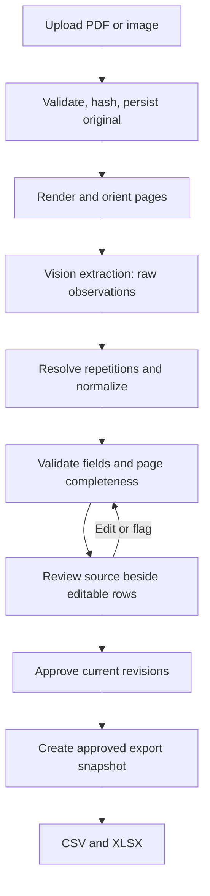

# Inventory sheet extraction design

Status: initial architecture, 2026-11-13. Canonical business and source entities implemented; extraction/review/export services remain scaffolds pending implementation and evaluation.

## Goal and assumptions

Convert inventory removal/sign-out sheets into CSV and XLSX, one row per line item. A reviewer can flag files or rows, correct values, and approve the exact revision exported.

Start with a single operator, low volume, local persistence, and mandatory review of every row. Input pictures/PDFs may have different layouts; all map to the fixed canonical fields below. Quantity/unit rules, date conventions, and item catalogue remain to be established from samples. Inventory balance updates and signature authentication are outside the initial scope.

## Canonical entities (implemented)

`schemas.py` defines the fields once in `InventoryRow`. `ProcessingRow` inherits them and adds internal `acceptance_level`, `source_row_id`, and `inherited_fields`. All layout adapters and review services must use these shared entities.

Business output headers, strictly in order: **Quantity · Price · Description · Person name · Job site · Job name · Job # · Date**. `OUTPUT_COLUMNS` derives from the base model. `to_output_dict()` projects exactly those fields, even on a processing row. `ProcessingRow.to_output_row()` produces a base entity. Internal `model_dump()` retains acceptance level for storage and must not be used directly as the business export.

Quantity and Price use finite `Decimal` values without assuming currency, rounding, unit-price versus line-total meaning, positivity, or integer-only quantities. Date is a calendar date; normalize source date conventions before validation. Job # and other text fields remain strings to preserve leading zeros. Python field names and exact output aliases are accepted. Unknown fields are forbidden and entities are immutable.

All eight values are nullable during processing so missing/illegible observations need not be guessed. Nullability is not export permission: later validation and approval policies will decide which missing values block export. Raw source entities are separate; persisted review events remain to be implemented.

Acceptance uses `high`, `med`, `low`, reflecting the current user-edited enum. Assignment rules remain pending; there is no automatic assignment. `None` means unassigned, not a fourth category. Acceptance is separate from human approval and never appears in business output.

## Source evidence entities (implemented)

- `SourceField`: literal `raw_text`, `kind` (`text`, `blank`, `ditto`, `illegible`), `uncertain`, an optional suggested `inherited_from` reference, and short evidence notes. Do not replace ditto marks with expanded text in this record.
- `SourceRow`: application-assigned `row_id`, one-based `row_number`, a dictionary of observed fields, `cancellation` (`active`, `cancelled`, `uncertain`), row uncertainty, and general notes. Retain cancelled rows for review rather than dropping them.
- `SourcePage`: document ID, one-based page number, header fields, ordered rows, layout notes, and general notes. Row IDs and row numbers must be unique within a page. An empty row list does not certify a blank or fully extracted page.
- `SourceReference`: document/page/row/field pointer. A null row number refers to a page header. Field keys and reference names must use existing Python field names from `InventoryRow`, such as `job_number`; validation reuses that model instead of repeating the eight field definitions.

Source field inheritance is an LLM suggestion, not a verified copy instruction. The future resolver must validate target existence, document/section boundaries, earlier-row order, and cycles before copying values. It records verified inheritance in `ProcessingRow.inherited_fields` and links the normalized row with `source_row_id`. Schema validation alone does not establish reference correctness. No resolution or automatic cancellation exclusion is implemented yet.

Keep stated evidence/uncertainty notes, raw responses, and the original page for audit. Notes describe model claims; they are not a record of private internal reasoning or proof that a transcription is correct. Extraction-run metadata (model, prompt/version, request/time) and human review events remain planned persistence concerns below. Preserve source observations when later human edits occur.

Keep implementation simple: use these nested Pydantic models and existing business fields rather than introducing a generic provenance framework. The current source entities do not implement rendering coordinates, storage, approval, or provider calls.

## Architecture

Use a modular Python application, initially one deployable process. A thin review UI calls application services; those services own persistence and state transitions. Microservices and an agent framework add little value to the initial sequential workflow.



Persist intermediate stages so reloads, timeouts, and retries do not erase work. LLM calls occur only in extraction; deterministic stages and manual edits can rerun against stored responses.

## Project layout

The structure below exists as a scaffold, including module responsibility descriptions, a draft extraction prompt, and draft rules. Application behavior is not implemented yet.

```text
app.py                  # review UI; no extraction or approval business rules
pipeline.py             # stage orchestration, run identity, retries
ingestion.py            # validation, hashing, PDF rendering, orientation
extractor.py            # provider adapter, structured response parsing
schemas.py              # typed observations, revisions, flags
resolver.py             # ditto dependencies and conservative normalization
validator.py            # versioned checks and risk reasons
review.py               # edits, flags, approvals, exclusions
storage.py              # transactions, revisions, audit events, artifacts
exporter.py             # approved snapshot to CSV/XLSX
prompts/
  extraction_v001.md    # versioned prompt sent to the vision model
config/
  rules_v001.json       # versioned field and repetition policies
samples/                # synthetic/anonymized examples only
tests/
  fixtures/             # labeled truth and recorded provider responses
data/                   # ignored originals, renders, responses, SQLite
outputs/                # ignored export snapshots and manifests
.env                    # local secrets; ignored
.env.example            # committed names/placeholders, no secrets
requirements.txt        # pin tested dependencies when implementation starts
README.md               # verified setup/run/deployment commands
notes/
  Prompts.md            # user development prompt audit log
  DESIGN.md             # decisions and rationale
  AGENTS.md             # collaboration and logging rules
```

A simple Python review UI and SQLite are suitable MVP choices. UI session state is a convenience, never the source of truth. Move to an API, durable worker queue, shared object storage, and PostgreSQL when concurrent jobs, reviewers, or hosting requirements justify them. Retain the service boundaries during that transition.

## Ingestion and evidence

Validate decoded file type, size, page count, and image dimensions rather than trusting filenames. Start with PDF, PNG, and JPEG. Fail explicitly for corrupt/encrypted PDFs and record failures per file/page. Never label a partially processed batch complete.

Store unchanged originals under generated document IDs and content hashes. Detect duplicate uploads by hash; distinguish an accidental duplicate from an intentional new extraction run. Never silently merge different sheets.

Render PDFs into page images at a recorded resolution. Preserve original renders and record rotation, deskew, scaling, and coordinate transforms. Embedded PDF text or OCR can supplement extraction; the visible sheet remains review evidence.

Start with page-level extraction to retain headers and row context. For dense pages, evaluate overlapping table crops with a page overview and deterministic overlap reconciliation. Retain the preceding row needed for a ditto mark. Validate model-generated row/cell coordinates before use; they are approximate pointers, not ground truth.

## Raw extraction contract

Request schema-constrained JSON and parse into typed objects. Preserve literal observations before resolving them. Do not ask the model to silently repair quantities, expand ditto marks, select catalogue items, or guess illegible text.

| Entity | Essential data |
| --- | --- |
| Document | ID, filename, content hash, ingest time, page inventory |
| Page | document ID, page number, render hash, dimensions, transforms, status |
| Extraction run | run ID, model/snapshot, prompt hash, schema/rule versions, parameters, request ID, times, usage, outcome |
| Observed row | assigned ID, run/page/table/order, source region, row classification |
| Observed cell | literal text, kind (`text`, `blank`, `ditto`, `illegible`), optional region, uncertainty reason |
| Resolved revision | row/revision ID, typed values, transformation reasons, source dependencies |
| Flag | target document/page/row/cell, reason code, severity, status, actor |
| Review event | actor, UTC time, action, target revision, before/after values, reason |
| Export | snapshot ID, approved revision IDs, scope, schema version, output hashes |

Assign stable IDs in application code. Store dates/quantities as raw text plus separately parsed values; use decimal quantities and explicit units. Keep identifiers such as `00123` as strings. Blank, illegible, and ditto remain distinct even when the typed value is null.

Record headers, section boundaries, crossed-out rows, and uncertain row candidates. Do not silently discard uncertain rows. Treat provider refusal, truncation, invalid JSON/schema, and timeout as failures or blocking review states, never as an empty successful table.

Structured output constrains shape, not transcription correctness. See the official [Structured Outputs guide](https://developers.openai.com/api/docs/guides/structured-outputs).

## Resolution and risk

Resolution creates a derived revision; validation returns explicit reason codes and severities. Low risk is not proof of correctness. Do not treat model self-reported confidence as a calibrated probability.

Ditto resolution needs an explicit policy per column. Copy only from a valid preceding cell within the same table section and record the dependency. A blank is not a ditto. Permission to repeat descriptions does not imply permission to repeat quantities. Block inference across headers, section boundaries, uncertain predecessors, and page boundaries unless an evaluated layout policy explicitly allows it.

When a predecessor changes, recompute dependent cells and invalidate affected approvals. A human override explicitly breaks or replaces its dependency; recomputation must preserve that override and flag a new conflict.

Checks should cover required fields, ambiguous dates, quantity/unit validity, unresolved repetition, unknown item IDs, conflicting catalogue suggestions, possible duplicates, and merged columns. Catalogue matches are suggestions unless a rule is demonstrably unambiguous; retain the handwriting transcription.

Start with `blocked`, `needs_review`, and `informational` flags rather than a numeric score. Row priority is the highest relevant field/page/document severity. Fixes resolve flags; explicitly permitted ambiguity can be acknowledged with a recorded reason. Required export values and structural failures remain blocking.

Plausible rows can still be missing. Account for every uploaded page and reconcile visible candidate rows. Row detection/count estimates are warning signals, not proof of completeness. Require a reviewer page-completeness sign-off against the full source page. Add an independent row detector/OCR pass only if evaluation shows it reduces omissions.

## Human review

Show the source page and highlighted row beside raw and resolved values. Support zoom, cell edits, whole-file/row flags, adding missed rows, splitting/merging row detections, and explicit exclusion of non-data/duplicate rows with reasons. Structural changes require source references and review events.

Persist row states such as `needs_review`, `approved`, and `excluded`; keep flags separate. A document is export-ready only when all pages are accounted for, completeness is signed off, all candidate rows have a disposition, and no unresolved blocking document/page flags remain.

Approve a specific revision with source/pipeline versions. Edits, new extraction runs, changed dependencies, and changed validation policies make affected approvals stale and require revalidation. Row structure edits invalidate page completeness sign-off. Every included row initially requires human approval, even with no flags.

Use transactional writes with an expected revision number so a stale UI cannot overwrite newer edits. A local MVP can record a configured operator identity, explicitly documented as self-asserted. Shared deployment needs authenticated identities and authorization checks in the service layer.

## Export and auditability

Enforce approval in the export service, not just the UI. Create CSV and XLSX from the same immutable approved snapshot in a transaction. Default complete-file export blocks on pending rows, pages, or flags. A batch may export fully approved files; its manifest identifies pending files. Never silently export part of a document.

Use stable configurable column order, UTF-8 CSV, and standard quoting. Write XLSX identifiers/free text as literal strings and preserve leading zeros. Define and test spreadsheet formula-injection handling in both formats, including `=`, `+`, `-`, `@` and leading control characters; CSV quoting alone does not prevent execution. Preserve original values in the audit store and document export escaping.

A separate manifest records source/run IDs, row revisions, exclusions, reviewers/times, export schema, and file hashes. Keep business tables clean. Preserve raw responses, derivations, and review events so each exported cell is traceable.

SQLite history and Git-reviewed Markdown are useful MVP records, but editable by someone with filesystem access. They are not tamper-proof. Stronger assurance needs restricted append-only storage and externally anchored hashes/backups. Define retention/access policies for originals and responses, which may contain names/signatures; keep real sheets out of Git.

## Model evaluation

Initial candidates, capabilities checked against official documentation on 2026-11-13:

- [GPT-5.5](https://developers.openai.com/api/docs/models/gpt-5.5): candidate quality baseline; supports image input and structured outputs.
- [GPT-5.4 mini](https://developers.openai.com/api/docs/models/gpt-5.4-mini): candidate lower-cost baseline; supports image input and structured outputs.

These are candidates to benchmark, not claims of handwriting accuracy or an exhaustive ranking. Pin an available snapshot after evaluation and record the actual returned model ID. Keep provider/model configuration outside deterministic rules.

Use page images through a vision-capable API with a versioned prompt. Consult the [vision guide](https://developers.openai.com/api/docs/guides/images-vision) for supported inputs and limits; small/rotated text and spatial localization need particular care. A crop retry or second model may help difficult rows; model agreement is not approval.

Create an initial labeled set of roughly 20–50 representative pages: clear print, messy handwriting, ditto chains, page breaks, crossed-out rows, duplicate scans, blur, rotation, missing fields, and blank pages. This is a starting dataset, not sufficient evidence of production reliability. Split tuning and held-out evaluation by document, not rows from the same sheet.

Measure row recall/precision, critical-field exact match (especially quantity/item ID), ditto accuracy, unflagged errors, review time, latency, and cost per approved row. Report transcription quality before edits separately from final output quality. Compare render/crop strategies on the same labels. Choose models and escalation policies from results rather than generic benchmarks.

## Implementation sequence and checks

1. Use the canonical entities above; establish layout mappings and repetition/date/unit policies from samples, and finalize acceptance categories/rules. Create labeled synthetic/anonymized fixtures and a versioned extraction prompt.
2. Implement schemas, ingestion, stored raw extraction, and replayable deterministic stages. Bound retry/backoff for transient errors; fail permanent errors explicitly. Key artifacts by source/render/prompt/schema/model settings so retries cannot duplicate rows. Replay stored responses for reproducibility; LLM reruns are not guaranteed identical.
3. Implement persisted review, dependency invalidation, flags, and completeness sign-off, then export snapshots.
4. Test invariants: unresolved ditto never guesses; upstream edits invalidate dependent approval; stale writes fail; failed/missed pages block export; unapproved rows cannot export; CSV/XLSX represent the same approved revisions and preserve text safely. Use recorded responses for routine tests and opt-in live model evaluations.
5. Benchmark held-out sheets, document verified local commands in README.md, then select hosting based on volume, authentication, retention, and reviewer concurrency.

## Decision record

| Date | Proposed decision | Reason |
| --- | --- | --- |
| 2026-11-13 | Modular monolith with persistent local state | Simple iteration with clean service boundaries |
| 2026-11-13 | Separate raw, derived, and reviewed values | Correction, replay, and traceability |
| 2026-11-13 | Ditto dependencies and page completeness review | Error propagation and silent omissions |
| 2026-11-13 | Revision-specific mandatory human approval | Risk rules cannot certify correctness |
| 2026-11-13 | Separate development log and runtime prompts | Different audit subjects and versioning |
| 2026-11-13 | Shared Pydantic business row plus inherited processing row | Variable input layouts map to eight fixed output fields; acceptance stays internal |
| 2026-11-13 | Simple page/row/field source models plus explicit inheritance references | Preserve cancellations, uncertainty, and evidence separately from resolved values |
